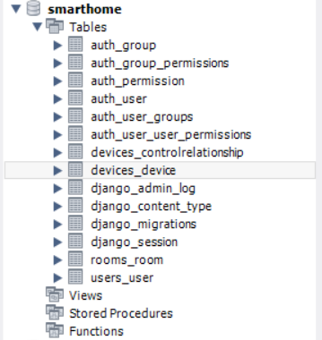
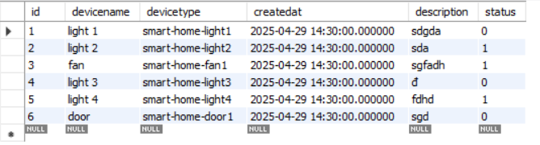
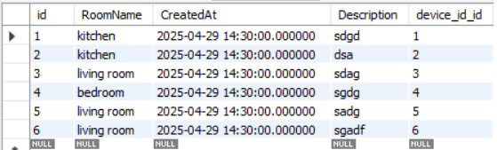

<!-- ## Table of Contents -->
- [Overview](#overview)
- [Facial Recognition Model](#facial-recognition-model)
  - [Logs](#logs)
  - [Kaggle Notebook \& Dataset](#kaggle-notebook--dataset)
  - [Pretrained Model](#pretrained-model)
    - [Usage](#usage)
  - [References](#references)
- [Installation](#installation)
  - [Prerequisites](#prerequisites)
  - [Setting Up the Backend](#setting-up-the-backend)
  - [Setting Up the Frontend](#setting-up-the-frontend)
- [Document](#document)
## Overview

A web application that facilitates the management and control of household devices, incorporating facial recognition technology for primary entrance authentication and voice command functionality to enable device interaction through verbal instructions.

## Facial Recognition Model
The smart home application integrates a facial recognition system powered by a Siamese Neural Network (SNN) to secure primary entrance authentication. The model verifies identities by comparing face image pairs, ensuring robust and accurate access control.
- Dataset: Utilizes the CelebA dataset with over 200,000 face images from 10,177 identities. Images are preprocessed (resized to 100x100, color-adjusted, and augmented with flips and rotations) and organized into 400,000 balanced positive and negative pairs for training and testing.
- Architecture: The SNN consists of twin convolutional networks (EmbeddingNet) sharing weights, extracting 4096-dimensional embeddings. L1 distance measures differences, followed by a fully connected layer for binary classification (same or different identity). Total parameters: ~38.6 million.
- Training: Trained on a GPU (NVIDIA Tesla T4) for 120 epochs using Binary Cross-Entropy loss and Adam optimizer (learning rate 0.0001). Techniques like dropout (0.2–0.3) and L2 regularization prevent overfitting.
- Performance: Achieves a test F1-Score of 0.8859 (Precision: 0.8879, Recall: 0.8840) at epoch 112, demonstrating strong generalization and accuracy for face verification.
Features: Robust to lighting and pose variations, suitable for one-shot learning, and optimized for real-time authentication in the smart home environment.
### Logs


### Kaggle Notebook & Dataset 
- 🔗 [Kaggle Notebook](https://www.kaggle.com/code/lnguyngiahng2111/yolo-siamese-model)  
- 🔗 [Preprocessed CelebA Dataset](https://mmlab.ie.cuhk.edu.hk/projects/CelebA.html)

### Pretrained Model
We provide a pretrained Siamese Neural Network (SNN) model for quick deployment and evaluation.  
This model has been trained on the CelebA dataset and optimized for real-time face verification tasks in the smart home environment.  

- 🔗 [Download Pretrained Model](https://drive.google.com/file/d/1jhg3O5lFYFy8qwruy0_JGtKMRFItOKEI/view?usp=sharing)

#### Usage
1. Download the pretrained model from the link above.  
2. Place the model file into the `models/` directory of the project.  
  
### References
[Siamese Networks for One-shot Image Recognition](https://www.cs.cmu.edu/~rsalakhu/papers/oneshot1.pdf)

## Installation

### Prerequisites

Before you begin, make sure you have the following installed:
- Python 3.12 or higher - [Download Python](https://www.python.org/downloads/)
- Node.js 16 or higher - [Download Node.js](https://nodejs.org/en/download/)
- npm (included with Node.js) or yarn - [Install Yarn](https://classic.yarnpkg.com/en/docs/install)
- MySQL 
    [For Windows](https://www.geeksforgeeks.org/how-to-install-mysql-in-windows/)
    [For Linux](https://www.geeksforgeeks.org/how-to-install-mysql-on-linux/)
- Adafruit Account with devices setup done
- Google Client ID [Follow the link to create account and get Google Client ID](https://blog.logrocket.com/guide-adding-google-login-react-app/)

### Setting Up the Backend

1. **Clone the repository**
   ```
   git clone https://github.com/yourusername/Smart_Home_Project.git
   cd Smart_Home_Project
   ```

2. **Create and activate a virtual environment**
   ```
   # For Windows
   cd backend
   python -m venv .venv
   .venv\Scripts\activate

   # For macOS/Linux
   cd backend
   python -m venv .venv
   source .venv/bin/activate
   ```

3. **Install dependencies**
   ```
   pip install -r requirements.txt
   ```

4. **Set up environment variables**
   Create a `.env` file in the directory `/backend` with the following:
   ```
   ADAFRUIT_AIO_USERNAME= # Your Adafruit username
   ADAFRUIT_AIO_KEY= # Your Adafruit key
   ADAFRUIT_AIO_FEED_DOOR1=smart-home-door1
   ADAFRUIT_AIO_FEED_FAN1=smart-home-fan1
   ADAFRUIT_AIO_FEED_LIGHT1=smart-home-light1
   ADAFRUIT_AIO_FEED_LIGHT2=smart-home-light2
   ADAFRUIT_AIO_FEED_LIGHT3=smart-home-light3
   ADAFRUIT_AIO_FEED_LIGHT4=smart-home-light4
   MYSQL_USERNAME= # Your MySQL username
   MYSQL_PASSWORD= # Your MySQL password
   MYSQL_DATABASE= # Your MySQL database name
   ```

5. **Set up the database**
   ```
   python manage.py makemigrations devices history rooms users
   python manage.py migrate devices history rooms users
   ```
   - Open MySQL Workbench, you might see the smarthome database like this
    
   - Add the data into devices_device table like this
    
   - Then do the same with rooms_room table
    
6. **Run the backend server**
   ```
   python manage.py runserver
   ```
   The backend will start at http://localhost:8000/

### Setting Up the Frontend

1. **From the project root directory, navigate to the frontend directory**
   ```
   cd frontend
   ```

2. **Install dependencies**
   ```
   # Using npm
   npm install

   # Using yarn
   yarn install
   ```

3. **Create environment file**
   Create a `.env` file in the frontend directory with:
   ```
   REACT_APP_API_URL=http://localhost:8000/api
   REACT_APP_GOOGLE_CLIENT_ID = # Your Goole Client ID
   ```

4. **Start the frontend development server**
   ```
   # Using npm
   npm start

   # Using yarn
   yarn start
   ```

## Document
The full project report, including detailed methodology, experimental setup, and analysis, is available in the document below.  
It provides an in-depth explanation of the smart home system design and the integration of the facial recognition model, with references to related works and evaluation metrics.  

📄 [View Full Report on Overleaf](https://www.overleaf.com/read/bvknrgztkddy#c5a878)